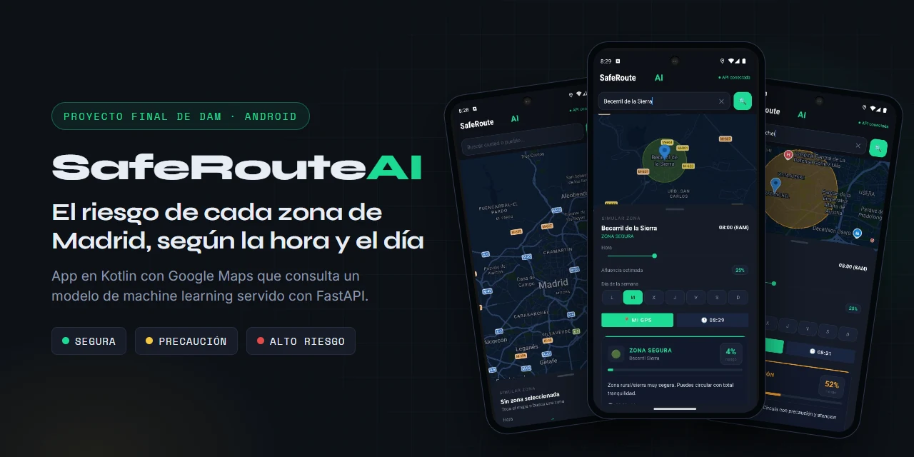
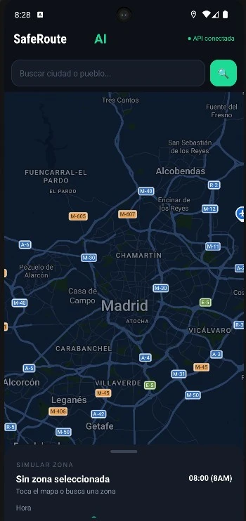
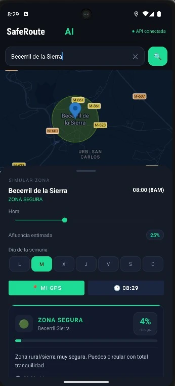
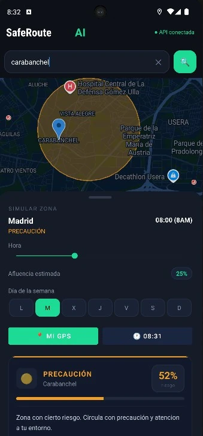
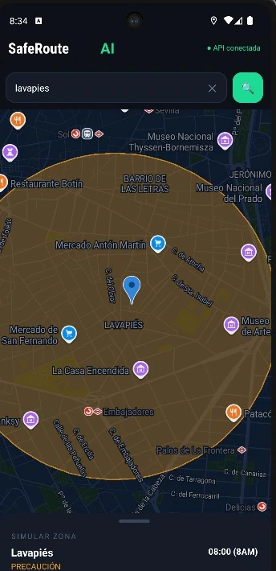
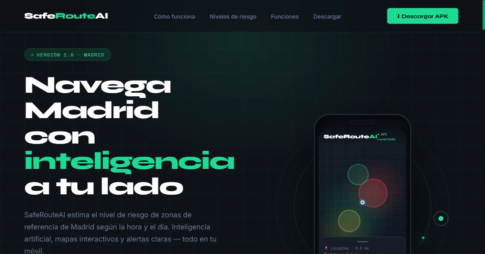
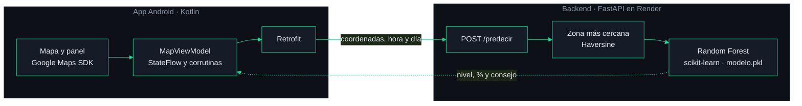

 

**App Android que muestra en un mapa de Madrid el nivel de riesgo de una zona según la hora y el día, con un consejo para el usuario.**

 

---

## En 30 segundos

SafeRouteAI es mi **proyecto final del ciclo de Desarrollo de Aplicaciones Multiplataforma** (DAM, junio de 2026).

- 🗺️ **Mapa de Madrid** con tu posición por GPS: toca una zona o busca una dirección.
- 🕗 **Simula el momento**: elige la hora con un deslizador y el día de la semana.
- 🤖 **Predicción en vivo**: la app consulta un modelo de machine learning servido con FastAPI.
- 🚦 **Respuesta clara**: verde, amarillo o rojo, con el porcentaje de riesgo y un consejo.

> **Sobre los datos:** el modelo se entrena con datos **simulados**, no con datos delictivos reales. Es un proyecto de aprendizaje y no sirve para decisiones de seguridad. Más detalles en el [repositorio del backend](https://github.com/cristian-corroto/saferoute-ai-backend).

---

## La app

<table>
<tr>
<td width="25%" align="center"> <b>Inicio</b> · mapa de Madrid y buscador.</td>
<td width="25%" align="center"> <b>Zona segura</b> · Becerril de la Sierra, 4 % de riesgo.</td>
<td width="25%" align="center"> <b>Precaución</b> · Carabanchel, 52 %, con su consejo.</td>
<td width="25%" align="center"> <b>Buscar</b> · cualquier zona, con su radio en el mapa.</td>
</tr>
</table>

Capturas reales de la app en un móvil Android.

<table>
<tr>
<td width="55%"></td>
<td width="45%" valign="middle">

### Web de presentación

Explica cómo funciona la app y sus tres niveles de alerta, y permite **descargar el APK** sin pasar por una tienda de aplicaciones.

[**saferoute.cristiancorroto.com →**](https://saferoute.cristiancorroto.com/)

</td>
</tr>
</table>

---

## Cómo funciona

1. La app obtiene la posición por GPS o la zona que toca el usuario (con el *Geocoder* de Android para las búsquedas).
2. Envía coordenadas, hora y día a `POST /predecir` con Retrofit.
3. El backend busca la zona conocida más cercana y el modelo Random Forest devuelve nivel, porcentaje y consejo.
4. La app lo pinta en el panel inferior y colorea la zona en el mapa.

| Capa | Tecnología |
|---|---|
| Interfaz | Kotlin · Android (minSdk 26) · Google Maps SDK |
| Estado | ViewModel · StateFlow · corrutinas |
| Red | Retrofit |
| Backend | Python · FastAPI · scikit-learn ([repositorio](https://github.com/cristian-corroto/saferoute-ai-backend)) |

## Estructura

| Archivo | Función |
|---|---|
| `MainActivity.kt` | Pantalla principal: mapa, buscador, deslizador y panel |
| `ui/MapViewModel.kt` | Estado de la pantalla y consultas al servidor |
| `data/Apiclient.kt` | Configuración de Retrofit |
| `data/Models.kt` | Modelos de petición y respuesta |

## Cómo compilarla

1. Abre el proyecto en Android Studio.
2. Copia `local.properties.example` como `local.properties` y rellena:
   - `sdk.dir`: la ruta a tu Android SDK (Android Studio suele crearla solo).
   - `MAPS_API_KEY`: tu propia clave de Google Maps con *Maps SDK for Android* activada. La clave **no** está en el repositorio.
3. Ejecuta la app en un emulador o en un móvil.

La app usa el servidor de demostración definido en `app/src/main/java/com/example/ai/data/Apiclient.kt`. Es un servidor gratuito: la primera consulta puede tardar cerca de un minuto mientras el servicio despierta.

## Limitaciones

- Datos simulados y solo 6 zonas de referencia (ver el backend).
- Necesita conexión a Internet para consultar la predicción.

## Autor

Desarrollada por **Cristian Corroto** como proyecto final de DAM, con apoyo intensivo de IA en casi todas sus partes. Yo decidí qué debía hacer la app, probé cada funcionalidad y la llevé hasta un APK instalable.

[Descargar el APK](https://saferoute.cristiancorroto.com/) · [Portfolio](https://cristiancorroto.com) · [LinkedIn](https://www.linkedin.com/in/cristian-corroto)
